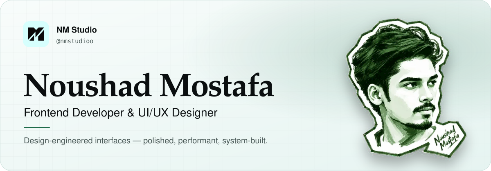
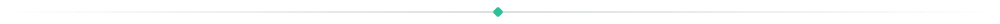
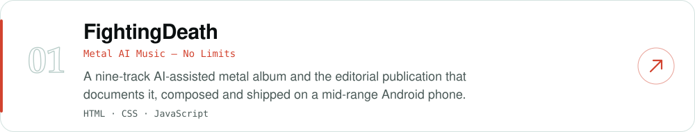
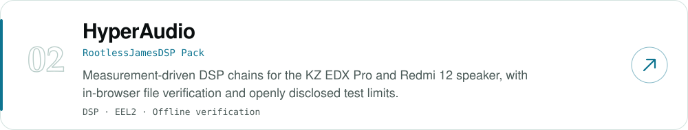
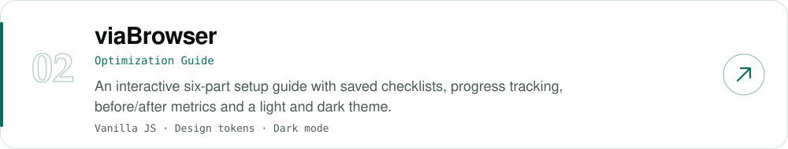
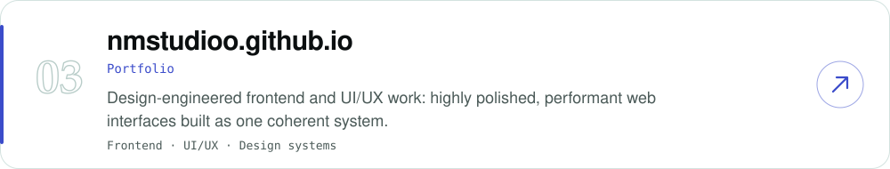
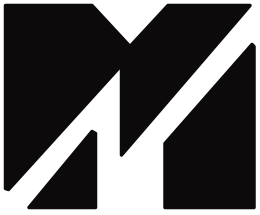

<picture>
<source media="(prefers-color-scheme: dark)" srcset="assets/banner-dark.svg">

</picture>

 

[**Portfolio**](https://nmstudioo.github.io/) &nbsp;·&nbsp; [**FightingDeath**](https://nmstudioo.github.io/FightingDeath/) &nbsp;·&nbsp; [**HyperAudio**](https://nmstudioo.github.io/HyperAudio/) &nbsp;·&nbsp; [**viaBrowser**](https://github.com/nmstudioo/viaBrowser) &nbsp;·&nbsp; [**NM Studio**](https://github.com/nmstudioo)

### About

I design and build web interfaces as one system: type, spacing, colour, motion and code decided together, so the result feels inevitable rather than assembled.

My work sits between interface design and frontend engineering. I care about restraint, readable typography, accessible contrast, mobile-first layout and pages that stay fast. I ship things that are small, finished and documented.

### Selected work

<a href="https://nmstudioo.github.io/FightingDeath/">
<picture>
<source media="(prefers-color-scheme: dark)" srcset="assets/card-fightingdeath-dark.svg">

</picture>
</a>

<a href="https://nmstudioo.github.io/HyperAudio/">
<picture>
<source media="(prefers-color-scheme: dark)" srcset="assets/card-hyperaudio-dark.svg">

</picture>
</a>

<a href="https://github.com/nmstudioo/viaBrowser">
<picture>
<source media="(prefers-color-scheme: dark)" srcset="assets/card-viabrowser-dark.svg">

</picture>
</a>

<a href="https://nmstudioo.github.io/">
<picture>
<source media="(prefers-color-scheme: dark)" srcset="assets/card-portfolio-dark.svg">

</picture>
</a>

### How I work

|  |  |
|:--|:--|
| **Systems over motivation** | Tokens, scales and constraints that produce consistent output on a bad day. |
| **Constraints create clarity** | Limited hardware and limited scope are design parameters, not obstacles. |
| **Evidence over intuition** | Look at the rendered result, measure it, then change it. |

### Craft

`Interface design` &nbsp; `Design systems` &nbsp; `Typography` &nbsp; `Frontend engineering` &nbsp; `React` &nbsp; `HTML · CSS · JavaScript` &nbsp; `Audio DSP` &nbsp; `Accessibility` &nbsp; `Performance`

<picture>
<source media="(prefers-color-scheme: dark)" srcset="assets/logo-dark.svg">

</picture>

Designed and built by Noushad Mostafa - NM Studio

