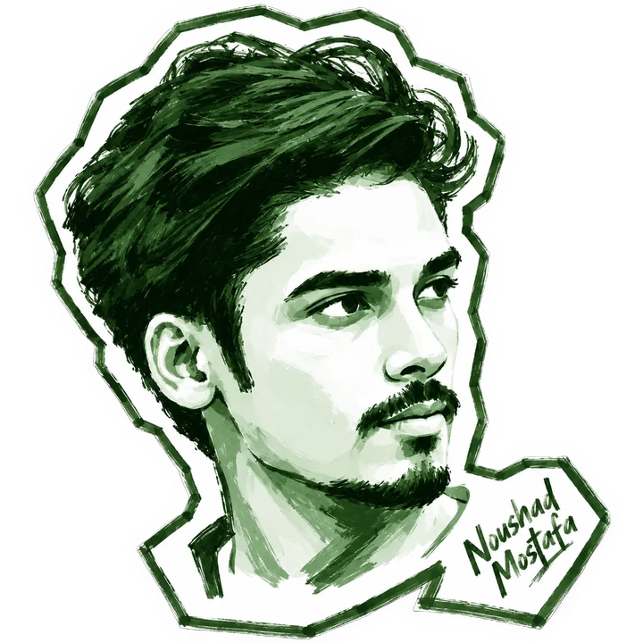

 

 

 
 

 
 

 

 
 

 

 
 

 
 

 
 
 

<picture>
<source media="(prefers-color-scheme: dark)" srcset="assets/logo-dark.svg">

</picture>

 

NM Studioo - System for Clarity.
 
Planned, Designed, Organized and built by Noushad Mostafa.

 

