

<picture><source media="(prefers-color-scheme: dark)" srcset="assets/portrait.png"></picture>

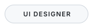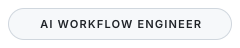 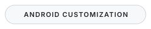

<a href="https://nmstudioo.github.io/">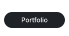</a><a href="https://nmstudioo.github.io/FightingDeath/">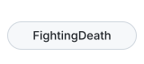</a><a href="https://nmstudioo.github.io/HyperAudio/">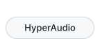</a><a href="https://github.com/nmstudioo/viaBrowser">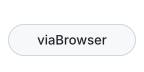</a><a href="https://github.com/nmstudioo">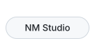</a>

<picture><source media="(prefers-color-scheme: dark)" srcset="assets/banner-dark.svg"></picture>

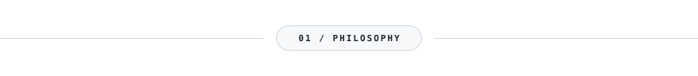

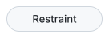 

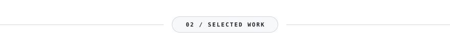

<a href="https://nmstudioo.github.io/FightingDeath/"><picture><source media="(prefers-color-scheme: dark)" srcset="assets/card-fightingdeath-dark.svg"></picture></a>

<a href="https://nmstudioo.github.io/HyperAudio/"><picture><source media="(prefers-color-scheme: dark)" srcset="assets/card-hyperaudio-dark.svg"></picture></a>

<a href="https://github.com/nmstudioo/viaBrowser"><picture><source media="(prefers-color-scheme: dark)" srcset="assets/card-viabrowser-dark.svg"></picture></a>

<a href="https://nmstudioo.github.io/"><picture><source media="(prefers-color-scheme: dark)" srcset="assets/card-portfolio-dark.svg"></picture></a>

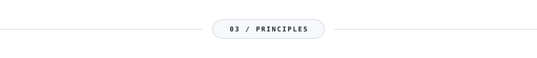

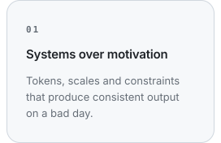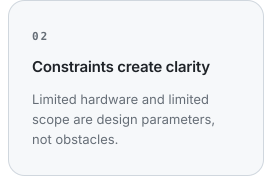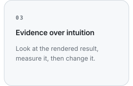


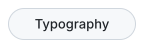 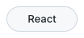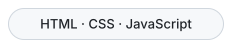 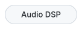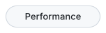

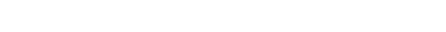

<picture><source media="(prefers-color-scheme: dark)" srcset="assets/logo-dark.svg"></picture>

